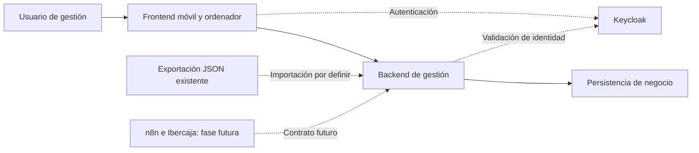

# Arquitectura — Portal de gestión de propiedades

## Title

| Field | Value |
| --- | --- |
| Document | Architecture Design Document |
| Initiative | Portal de gestión de propiedades |
| Version | 0.7 |
| Status | Draft - for review; partial design |
| Author | Conditor |
| Reviewers | Responsable del producto y responsable técnico — pendientes |
| Organization | Aelium |
| Last Updated | 2026-10-16 |

## 1. Overview

### 1.1 Purpose

Describir la separación de responsabilidades solicitada: backend para lógica y datos, frontend utilizable desde móvil y ordenador y autenticación mediante Keycloak. Este diseño parcial se apoya en las necesidades expresas del encargo, representadas en REQ-001, REQ-004, REQ-005 y REQ-006. No declara aprobadas las propuestas pendientes de la especificación.

### 1.2 Scope

Incluye límites del sistema, componentes lógicos, flujos y decisiones derivadas del encargo. La base técnica fue aceptada el 2026-10-03. El 2026-10-09 se confirmó acceso exclusivo del responsable, conservación de propiedades, inquilinos, pagos, incidencias, documentos y recibos, y registro de importes abonados y saldos. Esta revisión adapta el diseño a esas decisiones; reglas históricas y migración siguen pendientes. No acredita implementación. La automatización Ibercaja/n8n se representa únicamente como extensión futura.

La revisión del 2026-10-11 incorpora REQ-008, cuyo alcance de actualizaciones sin reinstalación general está confirmado. El usuario autoriza continuar con este diseño. ADR-012 a ADR-016 describen el mecanismo para la entrega Windows existente y el frontend publicado por separado. La revisión del 2026-10-16 registra implementación y evidencia local parcial conservada del 2026-10-11; la aceptación del cliente y la aprobación global del ADD siguen pendientes. El detalle operativo se conserva en [UPDATE-DESIGN.md](UPDATE-DESIGN.md).

## 2. Architectural Principles

- El backend es la autoridad de reglas, validaciones, persistencia y cálculos; el frontend presenta datos y solicita operaciones.
- La adaptación a móvil y ordenador comparte la misma fuente central de información.
- El acceso a datos se comprueba en backend; ocultar controles en pantalla no constituye autorización.
- Las propuestas no confirmadas mantienen su condición de propuestas. El esquema de datos final no se cierra mientras existan decisiones de dominio pendientes.
- Una actualización cambia los componentes de aplicación declarados, conservando dependencias, identidad y configuración no afectadas. Aplicación y esquema se verifican conjuntamente antes de permitir escrituras de negocio.
- Una instalación sin versión fiable no se considera compatible por defecto; se reconoce mediante evidencia de la entrega original.

## 3. System Context

Situación actual: un HTML con JavaScript, localStorage y sincronización directa con JSONBin. DOC.txt es una exportación de datos del dominio.

Destino: un portal accesible desde navegadores de móvil y ordenador. Keycloak es el servicio de identidad solicitado. El almacén de datos de negocio queda detrás del backend.

### Context Diagram

La interacción exacta entre frontend, backend y Keycloak depende del modo de sesión que se elija; el diagrama expresa responsabilidades, no un protocolo ya implementado.

Punto de partida de las actualizaciones: el repositorio contiene un instalador nativo Windows con servicios AeliumPostgres, AeliumKeycloak y AeliumAPI, más AeliumTunnel cuando se configura. La guía define frontend y proxy en Cloudflare Worker. No se ha inspeccionado el ordenador del cliente ni su cuenta Cloudflare; estos archivos no prueban qué versión tiene instalada. La autenticación de navegador vigente en el código local corresponde a ADR-011.

## 4. High-Level Architecture

### Components

| Component | Description |
| --- | --- |
| Frontend | Navegación, formularios y presentación adaptable; temática inmobiliaria de Zaragoza. Puede ayudar al usuario con validaciones, pero el backend vuelve a validar |
| Interfaz del backend | Recibe consultas y cambios; comprueba identidad y permisos; entrega resultados o errores |
| Lógica de negocio | Aplica reglas de propiedades, inquilinos y pagos; incidencias, documentos y recibos incluidos en el alcance confirmado |
| Persistencia de negocio | Guarda datos centrales y relaciones en PostgreSQL; esquema detallado pendiente |
| Keycloak | Autenticación de usuarios; realm, clientes y políticas de sesión pendientes |
| Importación | Capacidad propuesta para preservar identificadores y conciliar discrepancias del JSON existente |
| Preparación de actualizaciones | Implementación local: genera un paquete de aplicación identificable, con integridad, versiones de origen admitidas y compatibilidad de esquema, dependencias y frontend; no incluye distribuciones de dependencias sin cambios |
| Mantenimiento local | Implementación local: herramienta administrativa que conserva el estado previo, coordina servicios, copia, migración, comprobaciones y recuperación mediante un registro persistente |
| Lanzador de la API | Implementación local: selecciona la entrega activa y comprueba el estado de mantenimiento antes de arrancar; el arranque Windows normal no aplica migraciones |

La descomposición anterior es lógica. No obliga a desplegar cada componente como un servicio separado.

## 5. Data Flow

### Consulta y modificación

1. El usuario accede al portal y completa la autenticación.
2. El frontend solicita información al backend.
3. El backend valida la sesión y compara emisor y sujeto con la identidad única autorizada antes de acceder a datos u operaciones.
4. Para cambios, valida los datos y aplica las reglas de negocio antes de persistir.
5. El backend devuelve datos o errores; el frontend solo confirma cambios aceptados.
6. Una consulta desde otro dispositivo obtiene el estado central confirmado.

### Información del dominio

El origen relaciona inquilinos con propiedades y pagos con inquilino y mes. Incidencias y documentos pueden referenciar propiedades; documentos y recibos pueden asociarse a inquilinos. Este inventario no es todavía un esquema de base de datos.

Los nuevos pagos incluyen importe abonado e importe debido del período; el backend calcula saldo = debido − abonado cuando ambos son conocidos, con aritmética decimal exacta. Si falta alguno, el saldo es desconocido. No se transforma un estado parcial histórico en un importe conocido. No se eliminan automáticamente los cuatro pagos cuyo inquilino no aparece en la colección actual. La renta histórica y las correcciones de cobros requieren definición de producto.

### Transición propuesta

Conservar origen → validar exportación → reportar referencias y fechas a revisar → resolver discrepancias → importar en entorno de validación → comparar resultados → autorizar cambio operativo. Es una propuesta de transición, no una migración ejecutada.

### Extensión futura

n8n podrá entregar candidatos extraídos de avisos de Ibercaja al backend mediante un contrato todavía no definido. No tendrá acceso implícito al almacén de negocio. No se ha conectado ningún buzón ni sistema bancario.

### Actualización y recuperación — REQ-008

Paquete verificado y origen reconocido → compatibilidad comprobada → mantenimiento persistente y corte de escrituras → copia coherente comprobada → migración explícita → selección de aplicación candidata → comprobación de acceso y flujos → activación operativa. Si falla después de modificar el estado, la recuperación restablece aplicación, esquema, datos y configuración compatibles, manteniendo bloqueadas las escrituras hasta verificarlos. [UPDATE-DESIGN.md](UPDATE-DESIGN.md) define fases, archivos y tratamiento de interrupciones.

## 6. Technology Stack

| Layer | Technology |
| --- | --- |
| Frontend | Propuesta: HTML/CSS/JavaScript modular con Vite, conservando la base tecnológica del origen |
| Backend | Propuesta: Rust, Axum y SQLx; un backend modular |
| Identity | Keycloak solicitado; propuesta de cliente público con Authorization Code y PKCE S256; versión y realm pendientes |
| Persistence | Propuesta: PostgreSQL; esquema final pendiente de reglas de dominio |
| Integration | n8n previsto para fase futura |
| AI Layer | No solicitado |
| Infrastructure | Alojamiento, proxy, certificados, dominio y despliegue pendientes |

El usuario aceptó la base técnica el 2026-10-03: Rust/Axum/SQLx, PostgreSQL, frontend modular con Vite y Keycloak. Se toma como referencia el stack observado en CRM de Aelium sin copiar su configuración operativa. Versiones de aplicación se fijarán al implementar, mediante manifiestos y archivos de bloqueo. Proveedor y lenguaje no son requisitos de negocio obligatorios. La infraestructura local usa PostgreSQL 16.13 y Keycloak 26.7.4; no son una configuración de publicación.

## 7. Deployment Architecture

### Development

Propuesta: frontend, backend, identidad y persistencia verificables en entorno local, con datos sintéticos. La configuración concreta depende del stack; no existe todavía un entorno provisionado.

### Staging

Propuesta: entorno separado para validar autenticación, migración y uso en ambos formatos antes de operar con datos reales. Su existencia y coste no están confirmados.

### Production

Destino solicitado: portal web con acceso desde ordenador y móvil. Topología, disponibilidad, certificados y estrategia de recuperación pendientes. La base de negocio se accede a través del backend, sin credenciales maestras entregadas al navegador.

### Mantenimiento de la entrega Windows existente

Se conserva la raíz definida por el instalador, por defecto C:\ProgramData\Aelium\Propiedades, y los nombres, cuentas y puertos de los servicios existentes. Se añaden entregas de aplicación en releases/<releaseId>, un selector activo y un registro de operación; las carpetas de PostgreSQL, Java y Keycloak y el ejecutable/configuración del túnel se conservan. El selector y los registros no contienen secretos.

El lanzador estable scripts/run-api.ps1 se adapta una vez para consultar el selector y el estado; no se reinstalan wrappers ni se recrean usuarios. La transición desde la instalación antigua requiere identificación por hashes y protección temporal del arranque de servicios antes de introducir ese lanzador. Actualizar dependencias tiene un alcance separado, fuera del paquete habitual. El frontend se publica con compatibilidad de transición y recuperación explícitas según ADR-016.

## 8. Security Considerations

### Authentication

Keycloak ofrece OpenID Connect. Se propone utilizar su adaptador JavaScript con cliente público, Authorization Code y PKCE S256. El navegador no recibirá un secreto de cliente. Los tokens se mantendrán en memoria y no en localStorage; el backend validará firma, emisor, audiencia, expiración y los permisos que se definan. Por petición expresa del usuario, ADR-011 sustituye el acceso de navegador con redirección: el portal recoge usuario y contraseña y el backend solicita validación a Keycloak. Keycloak conserva la autoridad de autenticación; no se crea un almacén de contraseñas en el portal.

La configuración debe restringir las URI de redirección y los orígenes a los del portal. Cerrar sesión en Keycloak no se describirá como revocación instantánea garantizada de todos los tokens ya emitidos: deberán concretarse duración, estrategia de revocación y comportamiento esperado. La sesión en backend queda seleccionada en ADR-011 para el acceso integrado solicitado.

El diseño deberá definir validación de identidad, expiración, cierre de sesión y rechazo de solicitudes inválidas. Un inicio de sesión correcto no implica permiso para todas las operaciones.

### Authorization

El backend autoriza exclusivamente al responsable del producto, mediante una identidad configurada por emisor y sujeto estable, después de validar el token. Otro usuario autenticado recibe rechazo antes de cualquier lectura o escritura de negocio, incluidas descargas. No se autoriza por nombre visible ni correo. Si falta la configuración de identidad permitida, se deniega el acceso protegido. El identificador concreto queda pendiente de configurar; no se copia de CRM. Esta política se aplica a todas las rutas de negocio y permite usar varios dispositivos con la misma identidad.

### Data Protection

HTTPS y ausencia de claves maestras en el frontend son controles propuestos en NFR-005. La autenticación de Keycloak no sustituye el cifrado de transporte. Adjuntos, retención, copias de seguridad, registros de auditoría y obligaciones aplicables requieren definición antes de publicar.

Las actualizaciones se ejecutan como mantenimiento local administrativo, no mediante un endpoint remoto de instalación. Se comprueba el hash del ZIP frente a una referencia obtenida por el canal de entrega autenticado y cada archivo frente al manifiesto antes de ejecutar contenido. Las rutas se limitan a destinos declarados bajo la raíz verificada; no se admite contenido arbitrario sobre config, data o dependencias. Copias, configuración y credenciales mantienen ACL restringidas. Logs y resultados no contienen secretos. La primera entrega no se describe como firmada digitalmente: la firma de editor no existe en el instalador actual.

## 9. Architecture Decisions

| ID | Decision | Rationale |
| --- | --- | --- |
| ADR-001 | Situar reglas, cálculos y persistencia detrás del backend; el frontend solicita operaciones | Materializa la centralización expresamente solicitada |
| ADR-002 | Dar acceso a la misma información central desde una interfaz adaptable a móvil y ordenador | Responde al uso desde ambos dispositivos sin duplicar la autoridad de datos |
| ADR-003 | Utilizar Keycloak como servicio de autenticación y comprobar acceso a datos en backend | Materializa el acceso autenticado solicitado para el portal |
| ADR-004 | Incorporar la temática inmobiliaria de Zaragoza en la capa de presentación | Responde a la dirección estética solicitada sin acoplar reglas de negocio a la interfaz |
| ADR-005 | Propuesta: backend modular Rust/Axum/SQLx y PostgreSQL | Es el stack observado en CRM; mantiene reglas y persistencia detrás del backend y permite relaciones y transacciones; base técnica aceptada el 2026-10-03 |
| ADR-006 | Propuesta: frontend HTML/CSS/JavaScript modular con Vite y una API HTTP JSON versionada | Preserva la tecnología del origen y separa presentación de lógica central; no requiere introducir un framework de componentes |
| ADR-007 | Propuesta: cliente público Keycloak, Authorization Code con PKCE S256 y tokens en memoria | Define la integración de identidad sin secreto de cliente en navegador ni persistencia de tokens en localStorage |
| ADR-008 | Propuesta: validar importación primero y separar registros no conciliados antes de incorporar datos operativos | Los cuatro pagos con referencias ausentes impiden asumir una importación relacional directa sin revisión |
| ADR-009 | Autorizar en backend una única identidad por emisor y sujeto, con denegación por defecto | Realiza el acceso exclusivo confirmado sin conceder acceso a otros usuarios autenticados |
| ADR-010 | Persistir importes debidos y abonados por período como decimales exactos y calcular saldo en backend; conservar null histórico | Realiza el registro de importes y saldos sin fabricar cantidades a partir del estado o renta actual |
| ADR-011 | Formulario propio con validación de credenciales en Keycloak a través de cliente confidencial del backend; sesión opaca en cookie HttpOnly y tokens en servidor | Petición expresa del usuario de escribir credenciales desde el portal; sustituye el acceso de navegador de ADR-007, conservando validación de identidad exclusiva |
| ADR-012 | separar el paquete habitual de actualización del instalador completo y conservar entregas de aplicación identificadas, seleccionadas por un lanzador estable | Permite añadir funciones sin redistribuir dependencias ni reinicializar datos o identidad y conserva los componentes necesarios para recuperar |
| ADR-013 | manifiesto de actualización con origen, destino, integridad y compatibilidad explícitos; reconocer la entrega antigua mediante un catálogo de hashes revisado | El manifiesto existente no identifica una versión de aplicación; evita adoptar una instalación desconocida o una combinación incompatible |
| ADR-014 | registro persistente de mantenimiento, exclusión de operaciones concurrentes, protección del arranque de servicios y migración explícita antes del arranque normal sin migraciones | Impide que un reinicio o una comprobación de vida habiliten escrituras sobre una aplicación o esquema parcialmente actualizado |
| ADR-015 | copia coherente de negocio, identidad, configuración, adjuntos y componentes recuperables; restauración conjunta y verificada cuando cambia el esquema | Un ejecutable anterior no garantiza compatibilidad con datos migrados; el listado de un dump no demuestra su restaurabilidad |
| ADR-016 | contratos compatibles durante publicación y recuperación frontend–backend, con comprobaciones autenticadas y datos sintéticos aislados antes de activar operación normal | El frontend se entrega por separado y pueden coexistir pestañas antiguas; un cambio local no equivale a una publicación o reversión del Worker |
| ADR-017 | Para una instalación Docker nueva, publicar la API versionada en GHCR, ejecutar API, Keycloak y PostgreSQL en Compose y comprobar el canal desde una tarea de Windows; detener escritores, copiar ambas bases y migrar antes de activar una imagen nueva | Realiza la actualización sin intervención del cliente cuando Docker Desktop está activo, sin cambiar la instalación nativa; conserva imágenes y datos para recuperación |

ADR-001 a ADR-004 recogen el encargo. La base técnica de ADR-005 a ADR-007 fue aceptada por el usuario el 2026-10-03. ADR-008 y las reglas de conservación histórica siguen pendientes. ADR-009 y ADR-010 desarrollan las decisiones de producto del 2026-10-09; su diseño técnico se documenta aquí sin declararlo implementado. El estado de borrador del documento completo no se cambia a Approved.

ADR-012 a ADR-016 desarrollan REQ-008 confirmado el 2026-10-11. Tienen implementación y comprobación local parcial, con validación integral pendiente; no sustituyen ADR-001, ADR-003, ADR-009 ni ADR-011. Cambian el ciclo de entrega y arranque Windows, no la autoridad de datos ni la identidad autorizada.

## 10. Requirements Addressed

| Decision (ADR-xxx) | Requirement(s) satisfied | Notes |
| --- | --- | --- |
| ADR-001 | REQ-001 | Responsabilidad central del backend definida; stack aceptado el 2026-10-03 |
| ADR-002 | REQ-004 | Adaptación a ambos formatos; navegadores y dispositivos pendientes |
| ADR-003 | REQ-006 | Keycloak y control del backend; identidad exclusiva según ADR-009; configuración pendiente |
| ADR-004 | REQ-005 | Dirección visual definida; revisión de propuesta visual pendiente |
| ADR-005 | REQ-001 | Propuesta técnica; no implementada |
| ADR-006 | REQ-001, REQ-004 | Propuesta técnica; el contrato se detalla en API-CONTRACT.md |
| ADR-007 | REQ-006 | Propuesta técnica; permisos y despliegue pendientes |
| ADR-008 | REQ-002 | Propuesta condicionada a confirmar conservación de información histórica |
| ADR-009 | REQ-006, FR-007, NFR-004 | Acceso exclusivo; AC-007 incluye otro usuario autenticado |
| ADR-010 | REQ-003, FR-004, FR-005, NFR-006 | Saldo 600 − 250 = 350 según AC-012; desconocidos según AC-013 |
| ADR-011 | REQ-006, FR-007, NFR-004, NFR-005 | Usuario/contraseña en portal; validación de token y sujeto en backend, CSRF por origen, cookie y cierre de sesión local |
| ADR-012 | REQ-008, FR-013, NFR-008 | Paquete de aplicación y selección de entrega; AC-015, AC-016 y AC-108; implementación local parcial, aceptación pendiente |
| ADR-013 | REQ-008, FR-012, NFR-010 | Identificación del origen, rechazo previo y compatibilidad; AC-014 y AC-110; implementación local parcial, aceptación pendiente |
| ADR-014 | REQ-008, FR-016, NFR-009 | Fases persistentes, arranque y control de escrituras; AC-022, AC-023 y AC-109; implementación local parcial, aceptación pendiente |
| ADR-015 | REQ-008, FR-014, FR-016, NFR-007, NFR-009 | Copia, restauración y conservación; AC-017, AC-018, AC-021, AC-107 y AC-109; implementación local parcial, aceptación pendiente |
| ADR-016 | REQ-008, FR-012, FR-015, NFR-010 | Publicación compatible y validación de resultado; AC-014, AC-019, AC-020 y AC-110; implementación local parcial, aceptación pendiente |
| ADR-017 | REQ-009, FR-017 a FR-020 | Variante Docker nueva y actualización automática de API; AC-024 a AC-028; validación integrada pendiente |

REQ-002 requiere cerrar reglas de conservación. REQ-003 confirma importes abonados y saldos; siguen abiertas renta histórica, pagos múltiples, sobrepagos y correcciones. REQ-007 queda diferido. Ningún requisito se declara implementado por existir en esta tabla.

### Revisión del acceso integrado — ADR-011

El frontend deja de manejar tokens. POST /api/v1/session/login acepta credenciales, valida el origen del portal, solicita tokens a Keycloak y comprueba firma/emisor/audiencia/expiración/sujeto antes de crear sesión. Cliente confidencial y secreto solo en backend. Cookie opaca HttpOnly, SameSite Strict y Secure para origen HTTPS; excepción de HTTP solo en loopback local. Las escrituras con cookie, login y logout comprueban el origen autorizado. No se registran contraseñas ni tokens. Cache-Control no-store para sesión y respuestas protegidas.

Sesiones en memoria, máximo ocho horas y renovadas en servidor antes de caducar el token. Logout elimina la sesión local y solicita invalidación a Keycloak. Reiniciar backend exige nuevo login. Implementado y comprobado en entorno local; MFA, acciones obligatorias de cuenta, recuperación de contraseña y publicación HTTPS requieren diseño posterior. ADR-007 se conserva como antecedente y queda sustituida por ADR-011 para el flujo de navegador.

### Revisión de implementación del actualizador — 2026-10-16

Revisión limitada a ADR-012 a ADR-016 y REQ-008. Se han contrastado las herramientas locales y los informes conservados; no se han vuelto a ejecutar pruebas ni inspeccionado la instalación del cliente. El resto del ADD conserva su estado previo y requiere su propia conciliación con la implementación.

| Decisión | Implementación y evidencia local | Validación pendiente |
| --- | --- | --- |
| `ADR-012` | Constructor y verificador format=2; selección de entrega y repetición AlreadyApplied en pruebas sintéticas | Entrega cliente identificada y conservación de dependencias en instalación representativa |
| `ADR-013` | Verificación de hashes, origen y preflight integrado; catálogo sintético en ensayos | Catálogo del cliente revisado, observación real y compatibilidad de su frontend |
| `ADR-014` | Modos explícitos, guardia persistente, control de servicios y fases; pruebas de API y PostgreSQL | Ejecución SCM con administrador, servicios reales y reinicios Windows por fase |
| `ADR-015` | Copia de ambas bases e inventario de archivos/ACL, restauración aislada y recuperación con cuarentena | Identidad real, inventario del cliente y política revisada para migraciones que transforman datos |
| `ADR-016` | Orquestación, comprobaciones autenticadas sintéticas, estados pendientes y protección del formulario | Keycloak real, parejas de frontend–API y ruta Worker/Access/túnel reales; revisión independiente |

El [resumen local](../../tests/artifacts/updates/local-summary.json) registra 128 comprobaciones satisfactorias de alcance parcial, tres comprobaciones ACL adicionales y compilación frontend correcta; declara clientAccepted=false. Las simulaciones de identidad y portal no acreditan sus integraciones reales. Las familias del TMP y MS-003 siguen abiertas. Los límites de conservación y reanudación se detallan en [UPDATE-DESIGN.md](UPDATE-DESIGN.md#6-trazabilidad-y-límites). Esta revisión no cierra paquetes, no admite el origen real ni autoriza un despliegue.

## References

- [VSD](../VSD.md), [BRD](../_specification/BRD.md) y [revisión](../_specification/SPECIFICATION-REVIEW.md).
- [Requisitos de calidad](../_specification/NFRD.md).
- [Keycloak: OpenID Connect](https://www.keycloak.org/securing-apps/oidc-layers), consultado el 2026-10-02; sustenta únicamente la propuesta de integración de identidad.
- [Keycloak: reverse proxy](https://www.keycloak.org/server/reverseproxy), consultado el 2026-10-02; referencia para configurar un proxy si se elige esa topología.
- [Propuesta técnica y contrato de API](API-CONTRACT.md), revisión 2026-10-03.
- [Diseño de actualizaciones y recuperación](UPDATE-DESIGN.md), 2026-10-11, derivado de [FRD-005](../_specification/FRDs/frd-actualizaciones-cliente.md). Incluye fuentes oficiales de las restricciones técnicas y evidencia local examinada.
- [Axum](https://docs.rs/axum/latest/axum/), [PostgreSQL: constraints](https://www.postgresql.org/docs/current/ddl-constraints.html), [Vite](https://vite.dev/guide/) y [adaptador JavaScript Keycloak](https://www.keycloak.org/securing-apps/javascript-adapter), consultados el 2026-10-03.
